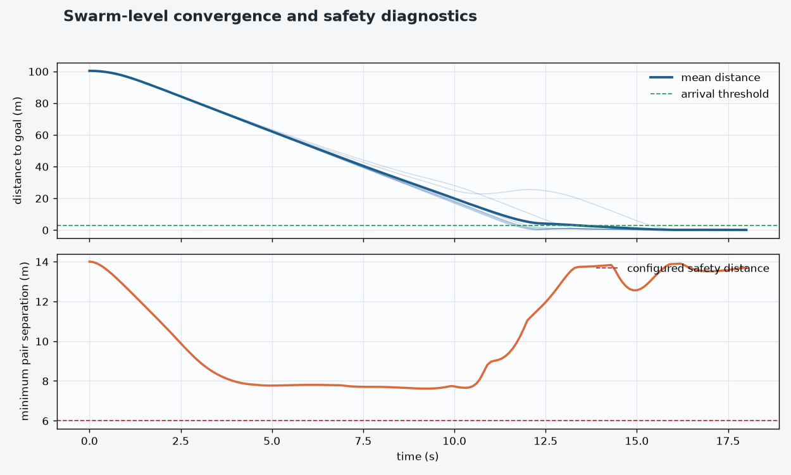

# 便携式察打共轴无人机智能集群系统

## 项目目标

- 以共轴双旋翼构型实现紧凑、可折叠、可快速部署的单机平台。
- 通过模块化载荷舱支持可见光侦察、红外侦察和其他任务载荷的快速切换。
- 建立六自由度非线性建模、状态估计和嵌入式飞控控制链路。
- 以分布式模型预测控制（DMPC）、人工势场（APF）和全局路径规划实现九机编队协同、避障和目标抵达。
- 形成“理论建模—结构与动力设计—飞控实现—集群仿真/试飞验证”的完整研发链路。

## 系统方案

```text
共轴双旋翼便携单机
    ├─ 上桨固定升力
    ├─ 下桨双舵机倾斜盘：滚转/俯仰
    ├─ 上下旋翼差速：偏航
    ├─ 可折叠桨叶与三段式模块化机身
    └─ 统一载荷接口
             │
             ▼
飞控与通信
    ├─ CC3D / STM32F103 + MPU-6000
    ├─ 互补滤波与 EKF 状态估计
    ├─ 双环 PID、混控、反扭矩补偿与振动抑制
    └─ LoRa/自组网接口与地面站扩展
             │
             ▼
九机集群控制
    RRT 全局航迹 → APF 局部避障 → DMPC 加速度优化 → 双积分器状态更新
```

### 单机与装备指标

| 项目 | 结题材料中的设计/验证指标 |
| --- | ---: |
| 旋翼直径 | 330 mm |
| 折叠后整机尺寸 | 不超过 220 × 80 × 80 mm |
| 空载机身重量 | 约 1.18 kg，目标不超过 1.2 kg |
| 单机续航 | 约 30 min，结题材料记录约 31 min |
| 姿态稳态误差 | 不超过 2° |
| 九机整装重量 | 不超过 16 kg |
| 集群部署时间 | 不超过 5 min |

单机动力方案采用两台 1806 无刷电机、两台 12 A 电调、两套 9 g 金属齿舵机和可折叠桨叶。结构模型和结题材料记录了两轮样机迭代、台架测试及户外试飞；本目录实际可直接复现的程序化验证集中在 `simulation/`。

## 仿真内容

仿真场景为 150 m × 90 m 的二维空域。9 架 UAV 以 3 × 3 编队从左侧出发，保持目标编队整体向右移动，场景包含 3 个禁飞区、4 个静态圆形障碍和 2 个往返运动的动态圆形障碍。

每架 UAV 使用状态 `x = [px, py, vx, vy]` 和加速度控制 `u = [ax, ay]`，离散动力学为：

```text
p(k+1) = p(k) + v(k)·dt + 0.5·u(k)·dt²
v(k+1) = v(k) + u(k)·dt
```

默认场景参数为 `dt = 0.1 s`、`Tmax = 70 s`、`vmax = 9 m/s`、`amax = 7 m/s²`、机间安全距离 `dsafe = 6 m`、MPC 预测步长 `N = 10`。RRT 只对静态障碍和禁飞区做带余量的线段检测；动态障碍和邻机风险由 APF、DMPC 及结果审计共同处理。

已有 MATLAB 实际轨迹的结果如下：

| 指标 | 结果 |
| --- | ---: |
| 仿真时长 | 18.0 s |
| 到达目标的 UAV | 9 / 9 |
| 全员首次进入目标 3 m 范围 | 15.5 s |
| 离散采样最小机间中心距 | 7.614 m |
| 步间核验最小机间中心距 | 7.614 m，阈值 6 m |
| 步间最小静态障碍表面净空 | 3.116 m |
| 步间最小禁飞区表面净空 | 6.560 m |
| 步间最小动态障碍表面净空 | 2.436 m |
| 碰撞样本/机间间距违规样本 | 0 / 0 |

步间结果来自 `matlab_clearance_audit.json`：审计对 UAV 的恒加速度段和动态障碍的线性插值段求解相对距离驻点，而不是只在离散记录点上取最小值。

## 目录结构

```text
.
├── README.md
├── 创新训练计划项目验收书v0.6.docx          # 项目验收书与结题报告
├── 第二组-19-便携式察打共轴无人机智能集群系统.pptx  # 结题答辩演示文稿
├── mechanism/
│   └── Tdrone.All parts.V1.SLDASM            # SolidWorks 总装模型
└── simulation/
    ├── README.md                             # 仿真模块的详细说明
    ├── main_swarm_sim.m                      # MATLAB/Octave 入口
    ├── run_swarm_sim.m                       # 规划、控制、积分、统计与 GIF 导出
    ├── swarm_world.m                         # 空域、障碍、编队与控制参数
    ├── swarm_rrt.m                           # RRT 全局规划、碰撞检测、捷径平滑
    ├── swarm_apf.m                           # 目标吸引与障碍/邻机排斥
    ├── swarm_mpc.m                           # 双积分器 DMPC 局部近似优化
    ├── swarm_draw.m                           # MATLAB 动画绘图
    ├── resample_path.m                        # 按弧长重采样路径
    ├── path_nearest_s.m                      # 线段投影与路径弧长定位
    ├── path_point.m                          # 按弧长插值取参考点
    ├── path_lookahead.m                      # 顶点最近点版本的前瞻工具
    ├── render_matlab_history.py              # 从 MAT 历史生成 GIF、快照和指标图
    ├── verify_matlab_history.py              # 步间连续净空审计
    ├── generate_swarm_visuals.py             # 绘图辅助函数（旧近似仿真入口已禁用）
    └── visualizations/
        ├── matlab_simulation.mat             # MATLAB 控制器实际状态历史
        ├── swarm_animation.gif               # 动态演示
        ├── stats.json                         # 离散统计摘要
        ├── matlab_clearance_audit.json       # 步间净空核验结果
        └── figures/                           # 0/3/.../18 s 快照和指标曲线
```

## 快速开始

### 1. MATLAB/Octave 运行仿真

需要 MATLAB 或 GNU Octave。将当前工作目录切换到 `simulation/`，然后运行：

```matlab
main_swarm_sim
```

该入口会加载场景、为每架 UAV 规划 RRT 路径、执行 APF + DMPC 闭环，并尝试实时绘图和导出 `swarm_animation.gif`。若只做无图形数值回归，可以运行：

```matlab
rng(7, 'twister');
W = swarm_world();
[stats, gifPath, history] = run_swarm_sim(W, false);
disp(stats)
save('visualizations/matlab_simulation.mat', 'W', 'stats', 'history', '-v7')
```

`history` 保存初始时刻及每个控制步的 UAV 状态、动态障碍状态和各机路径；`stats` 中的碰撞计数是离散时刻样本计数，不是去重后的碰撞事件数。

### 2. 核验连续净空

在 `simulation/` 目录下安装 Python 依赖 `NumPy`、`SciPy`、`Matplotlib` 和 `Pillow` 后运行：

```powershell
python verify_matlab_history.py visualizations/matlab_simulation.mat `
  --output visualizations/matlab_clearance_audit.json
```

脚本会对每个记录步内的恒加速度 UAV 轨迹和线性运动的动态障碍求连续最小距离；若静态/动态障碍净空为负，或机间距离低于 `dsafe`，程序以退出码 `1` 结束。

### 3. 从 MAT 文件重新生成交付物

```powershell
python render_matlab_history.py visualizations/matlab_simulation.mat `
  --output-dir visualizations
```

该命令会更新 `swarm_animation.gif`、`figures/swarm_t*.png`、`figures/swarm_metrics.png` 和 `stats.json`。`generate_swarm_visuals.py` 仅提供绘图函数；文件底部已明确禁止把旧的 Python 近似仿真当作当前结果来源。

## 已有可视化结果



动态演示：[swarm_animation.gif](simulation/visualizations/swarm_animation.gif)

典型状态快照：[起始帧](simulation/visualizations/figures/swarm_t000.0s.png)、[中间帧](simulation/visualizations/figures/swarm_t009.0s.png)、[终止帧](simulation/visualizations/figures/swarm_t018.0s.png)。

## 文件与成果对应关系

| 文件 | 用途 |
| --- | --- |
| `创新训练计划项目验收书v0.6.docx` | 项目背景、研究目的、数学建模、样机/飞控/集群成果、验收意见和结题总结 |
| `第二组-19-便携式察打共轴无人机智能集群系统.pptx` | 项目答辩版技术路线、关键指标、系统架构、样机和仿真结果展示 |
| `mechanism/Tdrone.All parts.V1.SLDASM` | 共轴无人机单机 SolidWorks 装配模型；需使用兼容版本的 SolidWorks 打开 |
| `simulation/visualizations/matlab_simulation.mat` | 可供 Python 渲染器和审计器复用的 MATLAB 实际状态历史 |
| `simulation/visualizations/stats.json` | 从 MAT 历史整理的离散统计摘要 |
| `simulation/visualizations/matlab_clearance_audit.json` | 连续步间净空审计结果，`passed: true` 表示本次记录通过 |

## 结果解释与工程边界

1. 仿真只描述二维位置和速度，不包含姿态、推力分配、气动耦合、通信时延、丢包、传感器噪声、电池能量和真实执行器动态。
2. DMPC 中的机间与障碍约束是软惩罚，不能单独视为硬安全约束或全局最优/无碰撞证明；应结合实际轨迹和 `verify_matlab_history.py` 的审计结果判断。
3. RRT 的全局规划不考虑动态障碍、其他 UAV 和实际跟踪误差；修改随机种子、障碍参数或控制权重后，应重新运行仿真、渲染和审计。
4. `path_nearest_s.m` 使用线段投影，是当前主循环使用的路径进度计算；`path_lookahead.m` 只比较路径顶点，属于备用工具。
5. `arriveTime` 是所有 UAV 曾进入各自目标 3 m 范围的锁存时间，不表示所有 UAV 在同一个采样时刻首次同时进入目标，也不等同于真实飞行任务完成时间。
6. 当前目录没有自动化 CI、依赖锁定文件或软件许可证；复现实验时应记录 MATLAB/Octave、Python、NumPy/SciPy/Matplotlib/Pillow 的版本。

## 参考材料

- 仿真模块详细说明：[`simulation/README.md`](simulation/README.md)
- 项目验收书：[`创新训练计划项目验收书v0.6.docx`](创新训练计划项目验收书v0.6.docx)
- 结题答辩文稿：[`第二组-19-便携式察打共轴无人机智能集群系统.pptx`](第二组-19-便携式察打共轴无人机智能集群系统.pptx)
- 机械装配模型：[`mechanism/Tdrone.All parts.V1.SLDASM`](mechanism/Tdrone.All%20parts.V1.SLDASM)

